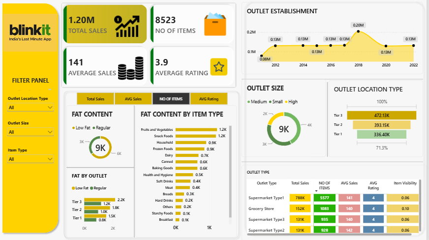

# Blinkit Grocery Sales & Performance Dashboard

A comprehensive Power BI data analytics project that analyzes sales performance, outlet metrics, and item trends for **Blinkit** (India's Last Minute App). This dashboard provides dynamic visual insights to help understand revenue drivers, inventory distribution, and store characteristics.

---

## 📊 Dashboard Overview



---

## 🚀 Key Performance Indicators (KPIs)

* **Total Sales:** \$1.20M
* **Total Items Sold:** 8,523
* **Average Sales:** \$141
* **Average Rating:** 3.9 / 5.0

---

## 🔍 Key Insights

### 1. Item Performance & Fat Content
* **Fat Content Preference:** Low Fat products drive higher sales volume compared to Regular fat items.
* **Top Categories:** *Fruits & Vegetables* and *Snack Foods* are the highest volume items (~1.2K units each).
* **Tier Performance:** Low Fat sales are highest across Tier 3 outlets (~2.2K units).

### 2. Outlet Performance & Location Tier
* **Outlet Establishment:** Sales peaked around 2018 establishing outlets (~0.20M in sales).
* **Outlet Size:** Medium-sized outlets represent the highest volume of items sold (~4K items).
* **Location Tier Revenue:**
  * **Tier 3:** \$472.13K (Largest revenue share)
  * **Tier 2:** \$393.15K
  * **Tier 1:** \$336.40K
* **Outlet Type Breakdown:** *Supermarket Type1* dominates total sales (**\$788K**) with 5,577 items sold and an average rating of 4.0.

---

## 🛠️ Interactive Slicers / Filters

* **Outlet Location Type:** Tier 1, Tier 2, Tier 3
* **Outlet Size:** High, Medium, Small
* **Item Type:** Multi-category filter (Fruits & Vegetables, Dairy, Snacks, etc.)

---

## 💻 Tech Stack & Tools

* **Tool:** Microsoft Power BI Desktop
* **Visuals Used:** KPI Cards, Line Chart, Donut Chart, Funnel Chart, Matrix, Bar Charts
* **Techniques:** DAX Measures, Dynamic Slicers & Page Navigation

---

## 📁 Repository Structure

```text
├── Blinkit_Analysis.pbix      # Power BI project file
├── blinkit_analysis.png       # Dashboard preview screenshot
└── README.md                  # Project documentation
